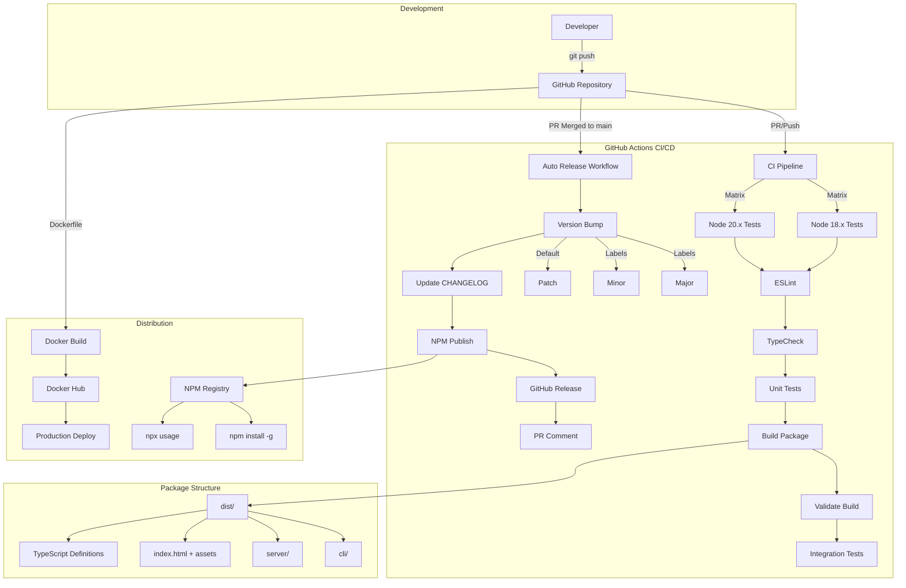
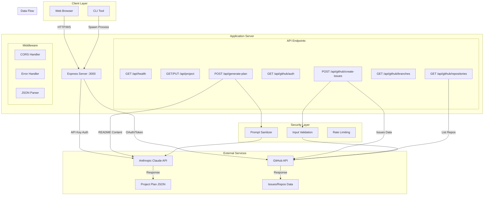
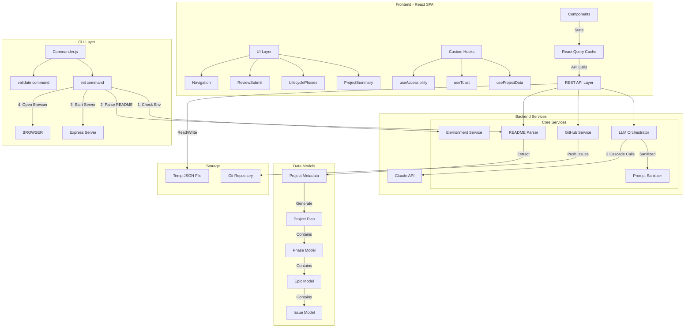
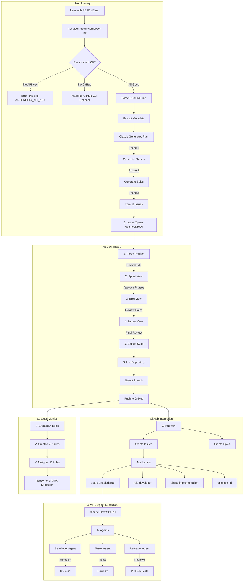

# Agent Team Composer - Architecture Diagrams

## 1. Deployment & CI/CD Pipeline

## 2. Networking & API Architecture

## 3. System Architecture & Components

## 4. User Workflow & Usage in the Wild

## Key Insights

### Architecture Highlights

- **Modular Design**: Clear separation between CLI, API, UI, and services
- **AI-Powered**: Claude 3 Sonnet generates comprehensive project plans
- **Progressive Enhancement**: Works with just Anthropic API, GitHub integration optional
- **SPARC-Ready**: Output formatted for autonomous agent execution

### Deployment Features

- **Zero Config**: Works with `npx` without installation
- **Multi-Platform**: NPM package, Docker container, or source
- **Automated Releases**: Semantic versioning with changelog generation
- **Matrix Testing**: Ensures compatibility across Node versions

### Networking & Security

- **API Gateway Pattern**: Express server handles all external API calls
- **Security Layers**: Input sanitization, prompt injection prevention
- **Graceful Degradation**: Continues working if optional services unavailable
- **Stateless Design**: Temporary storage cleared on completion

### Real-World Usage

- **Rapid Project Planning**: README → Full project plan in minutes
- **Agent Team Coordination**: Automatic role assignment for AI agents
- **GitHub-Native**: Creates issues/epics directly in repositories
- **Iterative Workflow**: Review and customize at each step
